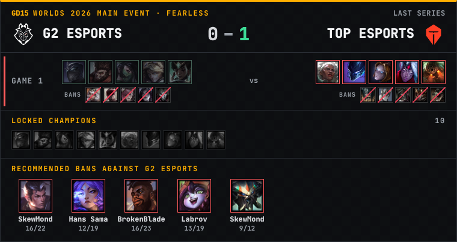

# GD15 overlays

Free OBS overlays for League of Legends esports casters and co-streamers, by
[GD15](https://x.com/gd15gg). Drop a URL in an OBS browser source and get a live
Fearless series panel: score, picks and bans of every game, locked champions and
the bans recommended against the team, updated on its own while the series is live.



## Quick start (no install)

1. In OBS: **Sources › + › Browser**.
2. URL:
   ```
   https://noamatout.github.io/gd15-overlays/series.html?team=G2%20Esports&bans=5
   ```
   (or the same page on the GD15 site:
   `https://leagueofstats-delta.vercel.app/overlay.html?team=G2%20Esports&bans=5`)
3. Width **800**, height **600**. The background is transparent.

The team name is the one used on [Leaguepedia](https://lol.fandom.com) (spaces as `%20`).

## Parameters

| Parameter | Default | What it does |
|---|---|---|
| `team` | required | Team to follow, e.g. `G2%20Esports`, `T1`, `Karmine%20Corp` |
| `bans` | `0` | Show the N bans recommended against that team (0 to 10) |
| `seriesbans` | `1` | `0` hides the bans of each game |
| `refresh` | `60` | Seconds between updates (15 s while the team is live) |
| `width` | `760` | Panel width in px |
| `lang` | `en` | `en` or `fr` |
| `preview` | off | `1` shows a checkerboard behind the panel, to test outside OBS |
| `api` | GD15 | Another GD15 instance to read from (self-hosting) |

## Where the data comes from

- Live series: the LoL Esports feed, then [Leaguepedia](https://lol.fandom.com) once the game is recorded.
- Recommended bans: each player's pro games since last year, weighted by recency and
  smoothed so that 2/2 doesn't beat 15/20 (details on [the GD15 site](https://leagueofstats-delta.vercel.app)).
- Champion icons: Riot's Data Dragon. Team logos: LoL Esports.

## Compatibility

Works in OBS 27 and later (its browser source is Chromium 75), so no modern-only
JavaScript or CSS here: no `?.`, no flex `gap`, no `replaceChildren`. Please keep it
that way in pull requests.

## Self-hosting / customising

The overlay is one HTML file plus `i18n.js`. Fork the repo, change the colours in the
`:root` block of `series.html`, then either open your copy through GitHub Pages or
point `?api=` at your own instance of the GD15 server.

## Contributing

Issues and pull requests are welcome: new overlays (draft phase, player cards…),
translations (add a dictionary to `i18n.js`), OBS fixes.

## Legal

GD15 is a fan project, not affiliated with or endorsed by Riot Games. League of
Legends and Riot Games are trademarks or registered trademarks of Riot Games, Inc.
Team logos belong to their teams and are loaded from LoL Esports, not shipped in
this repository. Code under the MIT licence.
